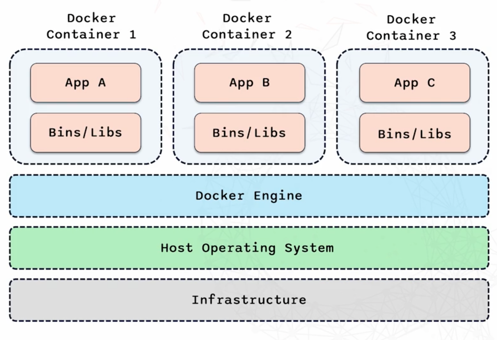

# Notes

## Introduction of Docker and Containers 
#### What are Containers?
- Containers are light weight, portable  units for running applications. 
- They bundle one applications with all of its dependancies ensuring that it runs consistently across different environments. 
- Example: You have an application and you want to run every part of the application. Containers will include the code, the run time, the libraries and anything I need, including all dependancies that the application needs to run. As containers are isolated it runs the same on any environment. 

 

- What is it showing in the above image?
1. You have 3 containers that sit above a Docker Engine 
2. Each container has its 'App' and its 'Binaries/Libraries' -> The app requires this to run
3. The Docker Engine sits on the Host Operating System. 
4. The Host Operating System sits above the Infrastructure 
- Infrastructure -> represents the physical, virtual hardware, where everything runs
- Host Operating System -> this is the OS that runs directly in the Infrastructure. It is the foundation for everything above it. e.g. MacOS HOS is MacOS. 
- Docker Engine -> is what makes containerisation possible. Provides the environment to build, run and manage containers. 
- Docker containers -> This isolation of each container, ensures each application runs consistently regardless of the environment. This is why App A doesnt affects App B, App B doesn't affect App C etc. 

#### Benefits of Containers 
1. Isolation -> containers isolate applications for each other and the underlying system -> prevents conflicts ensuring applications runs smoothly 
2. Consistent environment -> makes development and deployment more predictable and relibale. 
3. Efficient -> containers are more resource efficent than traditional virtual machines. They share the host OSkernal. This reducing overhead and allows more containers to run on the same hardware. 

#### What is Docker?  
- Docker is the most popular platform for managing containers 
- Docker is an open platfrom for developing, shipping and running applications in containers 
- Simplifies the process of managing containers, making it easier to build, deploy and run applications

##### Key components of Docker 
1. Docker Engine -> This the core service that runs and manages containers. Controls the whole thing. A portable, lightweight application runtime and packaging tool. 
2. Docker Hub -> is a repo, where you can find and share container images. Its like the App Store for Docker images. It is a cloud service for sharing applications and automating workflows. 

#### Images and Containers 

1. Images 
- Images are templates for creating containers.
- Images are snapshot of an application at a certain point in time.
- Images are immutable -> do not change once they are created
- - The immutabillity characteristic ensures that the applications runs consistently no matter where it is deployed. 

2. Containers 
- Containers are running instances of images 
- If an image is a recipe, a container is the dish you create from it. 
- Containers are what you interact with -> can start, stop, modify them as needed

- Docker file is used to create these images. Contains a series of instructions that docker uses to assemble an image 

#### Importance in Modern Development

1. Simplified deployment -> the biggest challenge with software development is ensuring that applications work consistently across different environments. This problem is solved by docker by creating an consistent environment from development to production. 
2. Improved efficiency -> Traditional virtual machines can be resource heavy and slow to start. Docker containers are lightweight and shares the Host System's Kernal which allows it to start up almost instantly. 
3. Enhanced collaboration -> docker allows collaboration with team members. You can just share the docker image with team and everyone is working in the same environment. Onboarding new developers becomes faster and less error prone. 
- - Docker integrates smoothly with CI/CD pipelines -> allows for automating testing, and deployment of containers. 

#### VMs vs Containers 

1. Virtual Machine 
- Allows multiple operating systems to run on a single physical machine. 
- At the base is the infrastucture. On top of that sits the host operating system. Above that is the hypervisor -> which is reponsible for creating and managing virtual machines by allocating resources like CPU, Memory and Storage. 
- Each virtual machine runs a full guest OS, which is completley isolated from others. 
- Within the setup of Applications, bin/libr, there is a strong isolationg 
- This means VM is resource heavy, taking up significant CPU, memory and storage. 

2. Containers 
- Containers are more lightweight and efficent way to isolate applications. 
- They share the whole Host operating system, but instead of using a Hypervisor, they run on the Docker engine. 
- Containers are isolated from each other at the process level but they share the same OS Kernal - making them much lighter than VMs 
- Containers can start up quickly and can use far lesser resources than VMs 

##### Key differences 

1. Virtual Machine 
- Startup -> Needs to boot up a full Guest OS -> can take minutes 
- Resource Usage -> Consume more resources 
- Isolation -> Strong isolation
- Portabillity -> Less portable due to size and dependencies on specific Hypervisor

2. Containers 
- Startup -> share the Host Operating System -> starts within seconds 
- Resource Usage -> Resource efficent 
- Isolation -> Process level isolation - is efficent but not robust like VM 
- Portabillity -> highly portable and can run consistently across environments 

## Docker Setup and Fundementals 
- docker --version -> see if installed 
- docker info -> information on the docker 
- docker run hello-world -> docker will search for this on your own terminal and if not found will take this out from its own library 
- docker ps -> shows any existing containers and info related to it 

#### What is a dockerfile?
- It is a series of instructions on how to build a docker image 
- Each instruction is in the docker file creates a layer in the image 
- Think of it as a recipe for creating your containerisation
- You are do repeatable builds - meaning you can create the exact same environment every single time 

#### Key comands of docker 
1. FROM -> specifies the base image to use for the Docker image 
2. RUN -> executes commands in the container. 
3. COPY -> copies files from the host machine into the container 
4. WORKDIR -> sets the working direcotry for subsequent instructions 
5. CMD -> specifies the command to run when the container starts 

##### Example 
- Use the official Node.js image as the base image FROM node:14
- Set the working directory in the container WORKDIR /app 
- Copy the package.json and package-lock.json files COPY package*.json ./
- Install dependencies RUN npm install 
- Copy the rest of the application code COPY ..
- Expose the application port EXPOSE 3000 
- Specify the command to run the application CMD ["node", "index.js"]

## Docker Networking 
#### Basic Networking concepts in Docker 
- Bridge network -> is the default network mode for containers on the same machine. Containers connected to the bridge network can communicate with each other using their own IP addresses. Isolated from your host machine network, proividing an extra level of security 
- Host Network -> In host mode, a container uses the host machines network directly without any isolation. Its as if the container is plugged directly into your home network, with no distincton between the container and the host. This mode is useful for applications that need to closley interact with the host system 
- None Network -> this option gives the container no network interface at all which makes it completley isolated. Its like a room with no doors or windows. 

- Think of containers as small portable apps and networks allow these apps to talk to each other, share data and function as a cohesive system. 

#### Docker Compose 
- Docker Compose helps you run multiple Docker containers together 
- Key features 
- - Docker-compose.yml file 
- - Commands 
- - Networking 

##### Importance in DevOps 
- Makes development and testing easier 
- Ensures consistency 
- Enhances Teamwork 

#### Docker Registries
- Docker Registry is a system for storing and sharing Docker images 
- Key features 
-  - Private registries 
-  - Public registries 

##### Importance of Docker Registries in DevOps 
- Steamline Deployment -> once your docker images is stored in a registry it cna be easily accessed and deployed across multiple environments, fro development all the way to production. Makes it faster and more reliable to roll out new features or updates 
- Enhances Collaboration -> when your images are stored, everyone on your team has access to the same resources making it easier to share and manage images. 
- Ensures conistency -> you can make sure that the exact same image is being used in development, testing and production. Means what you have tested locally is exactly what runs in production. 

## ADVANCED SECTION 
#### Containers for scratch 
- DevOps engineer job is to host applications on AWS, Cloud or any infrastructure 
- Docker, ECS, EKS are heavy in the industry 
#### Containers from First Principles
1. Basics: Where does it start from?
- You are a DevOps engineer and you are handed a file/zip/repo and you are asked "Hey can you containerise this and deploy it on ECS or Kubernetes?"
- This is real and happens everyday 

2. First question: How do I run this app normally?
- Before docker, before containers, before cloud, before base image 
- We MUST know how the app runs on a normal computer 

The rule:
- If you don't know how to run it normally 
- You will never know how to run it inside a container 
- GOAL -> find the app's entrypoint command 

Examples 
1. Python -> python app.py 
2. Node -> node index.js 
3. Go -> go run app.go 
4. Jave 
- - mvn package 
- - java -jar target/app.jar 
5. c# -> dotnet run 
6. PHP -> php -S localhost:8000

- Go, Jave etc. are compound languages. That means when you run that command, that language will create a binary. That binary is litreally your application. If you have that binary, and you put it in the container, it will RUN 
- Python and Node are NOT compound. It is in pure english but when you run it, it is a heavy applicaton on your laptop, container -> this is because it requires alot of dependencies to run

- Static site: Just open in a browser 
- Key insight: Every app already has an 'entrypoint' command 
- Docker does not invent anything - it just runs the same command inside the container 

